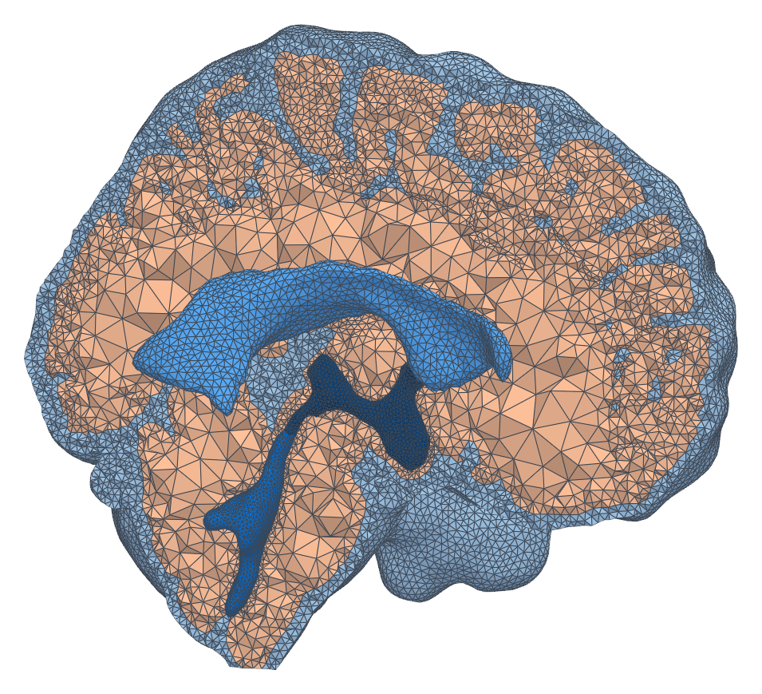

# brainmesh – Segmented MRI to brain mesh

Complete pipeline for generating brain meshes with local refinement from MRI segmentations.

<p align="center"></p>
<p align="center">Example mesh</p>

## Environment setup
Before running the pipeline, set up the conda environment with:
```bash
conda env create -f environment.yml
conda activate brainmesh
```

## Data
T1-weighted MRI images from [Williams et al., 2023](https://doi.org/10.1371/journal.pbio.3002035) (subjects 01–06) were downloaded from [OpenNeuro (ds004478, v1.0.2)](https://openneuro.org/datasets/ds004478/versions/1.0.2).
The images were preprocessed with fMRIPrep (output space `MNI152NLin2009cAsym`) and segmented with SynthSeg; these segmentations are in `mridata_raw/`.
The segmentations are then cleaned with `clean_ventricles.py` (inferior horns and disconnected ventricle fragments are reassigned to the nearest tissue), with output in `mridata/`.

## Full pipeline
To run the entire pipeline sequentially, use the `full` command and provide a subject ID, the input segmented MRI, and a configuration file. 

```bash
python mesh_workflow.py full \
  sub01 \
  mridata/sub-01_synthseg.nii.gz \
  meshconfigs/sub01.yml
```

What this does:
1. Extracts surfaces $\rightarrow$ `surfaces/sub01/`
2. Generates base mesh $\rightarrow$ `meshes/sub01/work/`
3. Tags boundaries & interfaces $\rightarrow$ `meshes/sub01/work/sub01_marked.xdmf`
4. Fixes overconstrained cells $\rightarrow$ Outputs the final mesh to `meshes/sub01/sub01.xdmf`
5. Optionally refines mesh locally (with `--refine-steps 1` or more) $\rightarrow$ Then this step outputs the final mesh
6. Archives config $\rightarrow$ Copies config to `meshes/sub01/sub01.yml.`

**Note**: To view all available pipeline steps and usage instructions from the command line, run `python mesh_workflow.py steps`.

## Detailed pipeline steps

Each script can also be run independently. 

### 1. Extract surfaces
Extracts PLY surfaces from a segmented MRI.

```bash
python extract_surfaces.py \
  --input mridata/sub-01_synthseg.nii.gz \
  --config meshconfigs/sub-01-mesh.yml \
  --output surfaces/sub01/
```


### 2. Generate base mesh
Uses fTetWild (wildmeshing) for volumetric mesh generation using the surface files from step 1. A sizing field sets the edge length per region, with edges growing away from these regions up to `--coarse-edge-mm`:

| Option | Default | Region |
|---|---|---|
| `--sas-edge-mm` | 2.0 | SAS, including the spinal part |
| `--lv-edge-mm` | 2.0 | Lateral ventricles |
| `--v3v4-edge-mm` | 1.0 | Third and fourth ventricles, aqueduct |
| `--coarse-edge-mm` | 10.0 | Everything else, mainly deep parenchyma |

In the parenchyma, the folded pial surface keeps cells small (about 2.4 mm median), whatever `--coarse-edge-mm` is. `--epsilon` sets how far the mesh surfaces may deviate from the PLYs, relative to the bounding box diagonal. Keep it at the default, 0.001, or below: on sub03, 0.0015 enlarged the LV–V3 contact and split it into more fragments, and on sub01, 0.002 made fTetWild abort while simplifying the surfaces.

Where surfaces nearly coincide (LV and V3 at the foramina of Monro, V3 and V4 at the aqueduct), fTetWild can leave a few cells with the wrong marker. These would show up as fragments on the interfaces and can partly block the aqueduct, so any cluster of parenchyma, LV, V4 or V3 cells cut off from the main region is merged into its neighbour. Small pockets of SAS enclosed by the parenchyma surface are kept.

```bash
python generate_mesh.py \
  --surface-dir surfaces/sub01/ \
  --output-dir meshes/sub01/work
```

### 3. Tag boundaries and interfaces
Generates both `boundaries` and `boundaries_split` markers inside the mesh file.
```bash
python tag_boundaries.py \
  meshes/sub01/work/work.xdmf \
  --output meshes/sub01/work/sub01_marked.xdmf \
  --configfile meshconfigs/sub-01-mesh.yml
```


### 4. Fix overconstrained cells

Identifies and refines "overconstrained" tetrahedral cells (cells with all 4 vertices on the boundary, which are problematic for Stokes) by splitting them while preserving mesh and facet tags.

```bash
python fix_overconstrained_cells.py \
  meshes/sub01/work/sub01_marked.xdmf \
  --output meshes/sub01/work/sub01_fixed.xdmf
```

### 5. Refine mesh locally (optional)
Performs local refinement in thin regions (SSAS, aqueduct). The sizing field in step 2 already resolves these regions, so the full pipeline only runs this step with `--refine-steps 1` or more.

```bash
python refine_mesh.py \
  meshes/sub01/work/sub01_fixed.xdmf \
  --output meshes/sub01/sub01.xdmf \
  --refine 1
```


## Configuration and output

### Skipping pipeline steps
The `mesh_workflow.py` script supports skipping specific parts of the pipeline if you only need to rerun later stages. Use `--help` to see all options:
* `--skip-surfaces`
* `--skip-mesh`
* `--skip-tags`
* `--skip-fix`
* `--skip-refine`

### Configuration files
The mesh configuration files (like `sub01.yml`) specifies clipping planes for surface extraction, e.g.:
```yaml
surface:
  clip_origin:
    x: 0.0
    y: 0.0
    z: -0.05  # mm
  clip_normal:
    x: 0.0
    y: 0.0
    z: 1.0
  clip_aq_origin:
    x: 0.0
    y: 0.0
    z: 0.0
  clip_aq_normal:
    x: 0.0
    y: 1.0
    z: 0.2
```
Inspect the geometry in Paraview to find appropriate values.  

The config files can also contain information about the mesh tags for later simulations, or define specific points for postprocessing.


## Markers

The generated mesh tags follow the following conventions. 

### Subdomains (Cells)

We generate two sets of subdomain markers. The `subdomains` tag separate the porous and fluid domains:
| ID | Type | Domain | Description |
| :--- | :--- | :--- | :--- |
| **`1`** | Subdomain | Porous | Parenchyma |
| **`2`** | Subdomain | Fluid | Subarachnoid space and ventricles |

The `subdomains_ftetwild` further separates the fluid space (for postprocessing purposes), as:
| ID | Type | Domain | Description |
| :--- | :--- | :--- | :--- |
| **`1`** | Subdomain | Fluid | Subarachnoid space |
| **`2`** | Subdomain | Porous | Parenchyma |
| **`3`** | Subdomain | Fluid | Lateral ventricles |
| **`4`** | Subdomain | Fluid | Fourth ventricle |
| **`5`** | Subdomain | Fluid | Third ventricles |

### Boundaries and interfaces (Facets)
The `boundaries` facet tags contain:
| ID | Type | Description | Notes |
| :--- | :--- | :--- | :--- |
| **`1`** | Interface | Tissue-CSF Interface | Pia + ependyma|
| **`2`** | Boundary | Skull | Outer boundary |
| **`3`** | Boundary | Spinal Canal | Bottom fluid boundary |
| **`4`** | Boundary | Spinal Cord | Bottom porous boundary |
| **`5`** | Interface | Aqueduct | Internal interface for flow computation |

In `boundaries_split`, the interface (1) is split into two separate tags:
| ID | Type | Description | Notes |
| :--- | :--- | :--- | :--- |
| **`11`** | Interface | Pial Membrane | SAS-parenchyma interface|
| **`12`** | Interface | Ependyma | ventricle-parenchyma interface|
| **`13`** | Interface | SV | SAS-ventricle interface|

The remaining tags are as in `boundaries`.

